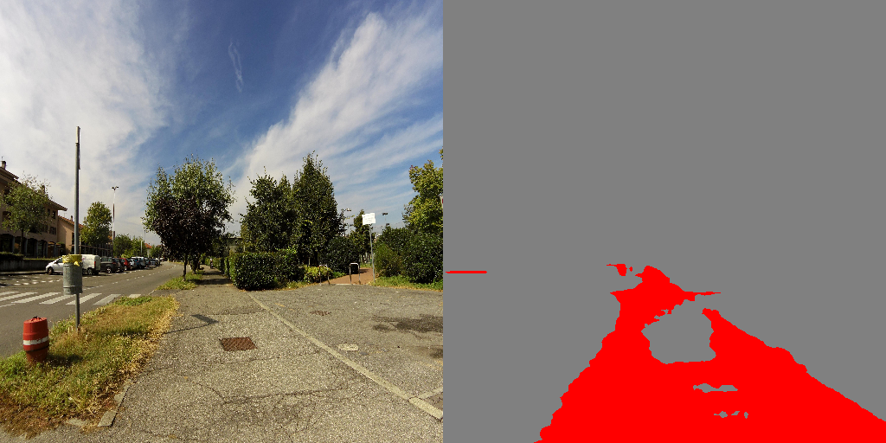
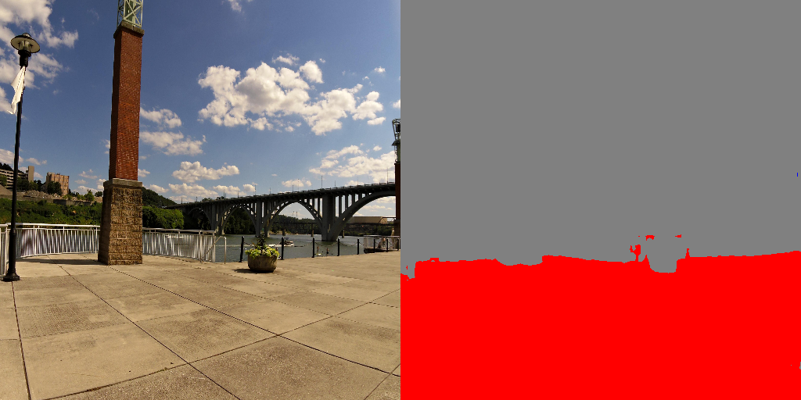
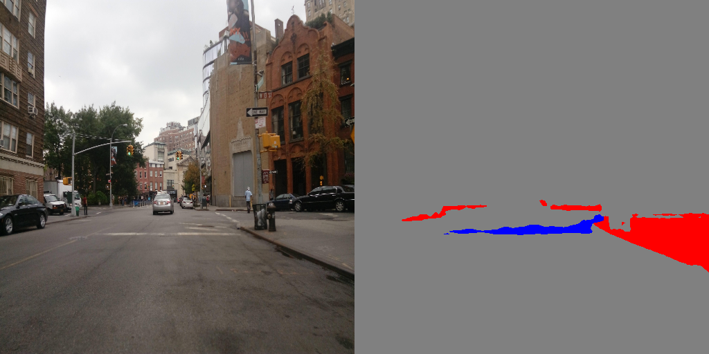
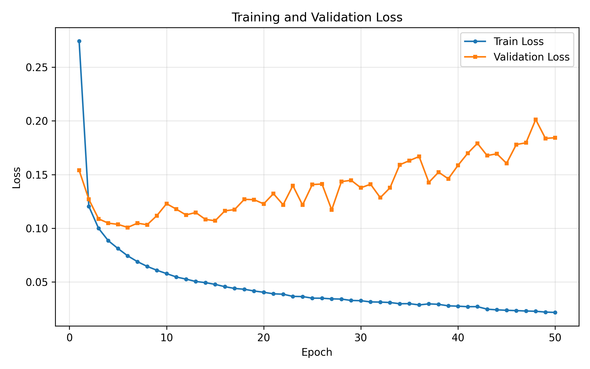
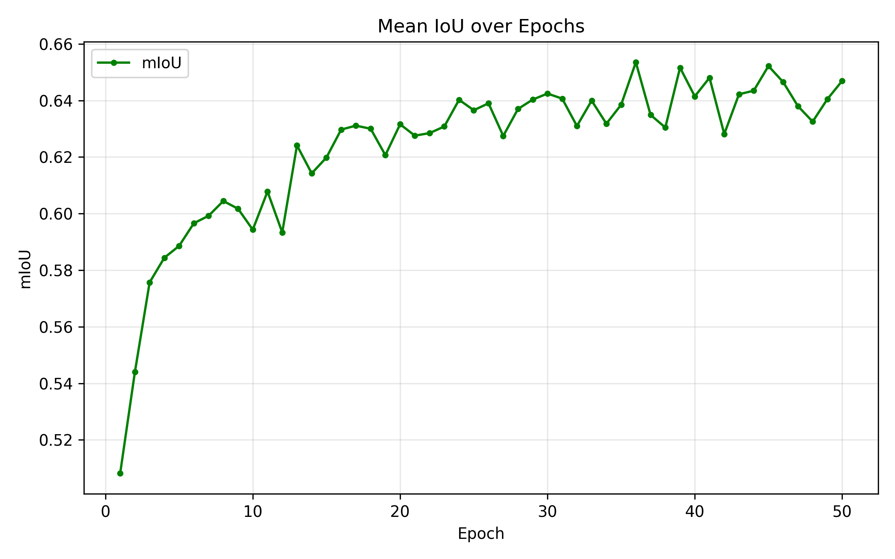
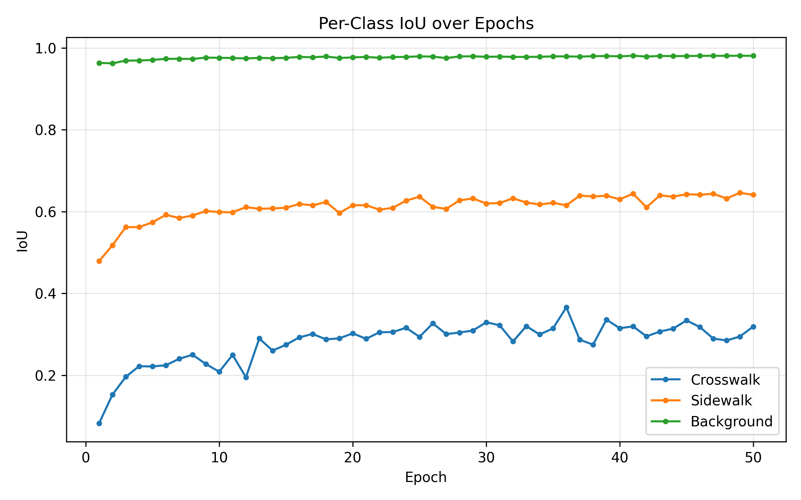

# UGV Sidewalk & Crosswalk Segmentation (DeepLabV3+ / ResNet-50)

Semantic segmentation that tells my autonomous ground vehicle (UGV) **where it is allowed to drive**: sidewalk and pedestrian areas, crosswalks, and everything else. This was the first drivable-area model of my M.S. thesis UGV at the University of North Dakota. In the final system I replaced it with a pretrained Mask2Former (Swin-Large, full Mapillary Vistas) because it generalized better to field lighting; this repo documents the custom-trained model and what I learned from it.

| Input + prediction | Input + prediction | Input + prediction |
| :---: | :---: | :---: |
|  |  |  |

*Colors:* **red** = sidewalk / pedestrian area, **blue** = crosswalk, **gray** = background.

---

### Approach

* **Model:** DeepLabV3+ with a ResNet-50 encoder (ImageNet-pretrained encoder, decoder trained on this task), built with `segmentation_models_pytorch`.
* **Data:** Mapillary Vistas v2.0 street-level images. Its color-coded masks are **remapped to 3 classes**: crosswalk, sidewalk (sidewalk + pedestrian area merged), and background.
* **Class imbalance:** crosswalks cover a small fraction of pixels, so the loss is class-weighted (crosswalk 3.0, sidewalk 1.5, background 0.5).
* **Outdoor robustness:** augmentation with random resized crops, flips, small affine transforms, and brightness / contrast / saturation jitter for sun and shadow.
* **Training:** 512 x 512 input, Adam (lr 1e-5), learning rate halved on mIoU plateau, 50 epochs, best checkpoint saved by validation mIoU. Every epoch logs loss, pixel accuracy, mIoU and per-class IoU (`results/metrics.csv`).

### Results (validation set, best epoch)

| Pixel accuracy | mIoU | IoU crosswalk | IoU sidewalk | IoU background |
| :---: | :---: | :---: | :---: | :---: |
| 0.980 | **0.653** | 0.366 | 0.615 | 0.979 |

| Loss | mIoU | Per-class IoU |
| :---: | :---: | :---: |
|  |  |  |

**Honest read:** sidewalk and background are reliable; crosswalk is the hard class (small, thin, often worn paint and seen at sharp angles), and validation loss bottoms out early (around epoch 6) and then drifts up while mIoU keeps improving, so the best checkpoint is chosen by mIoU, not loss. This is also why my vehicle's navigation does not make crosswalk decisions from a single frame: it uses a short, bounded commitment while LiDAR and person stops stay active.

### Files

| File | Purpose |
| --- | --- |
| `train.py` | dataset + class remapping, augmentation, training loop, metrics and plots |
| `test_images.py` | run the best checkpoint on a folder of images and save side-by-side overlays |
| `test_video.py` | run the model frame by frame on a video |
| `results/` | metrics per epoch and training curves |

### Run

```bash
pip install -r requirements.txt
# put Mapillary Vistas v2.0 under training/ and validation/ (images + v2.0/labels)
python train.py
python test_images.py      # expects output/moveable_aug_bright/best_model.pth
```

Weights are not included (over GitHub's 100 MB limit); available on request.

### License
MIT
